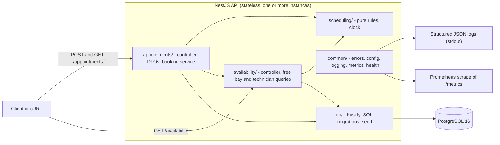
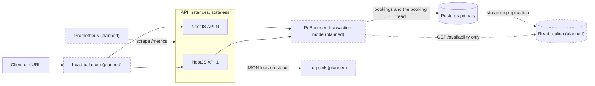
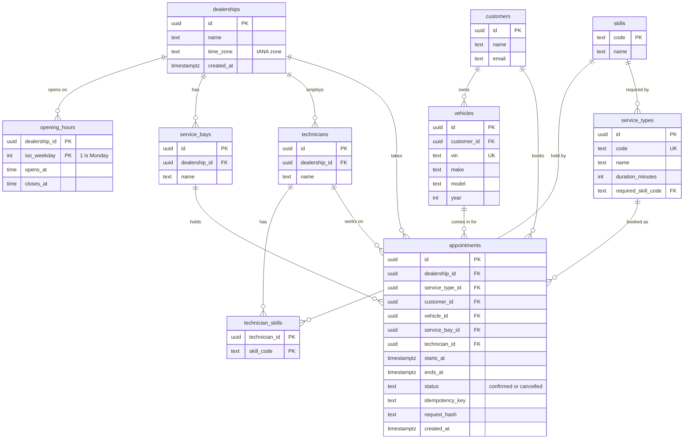
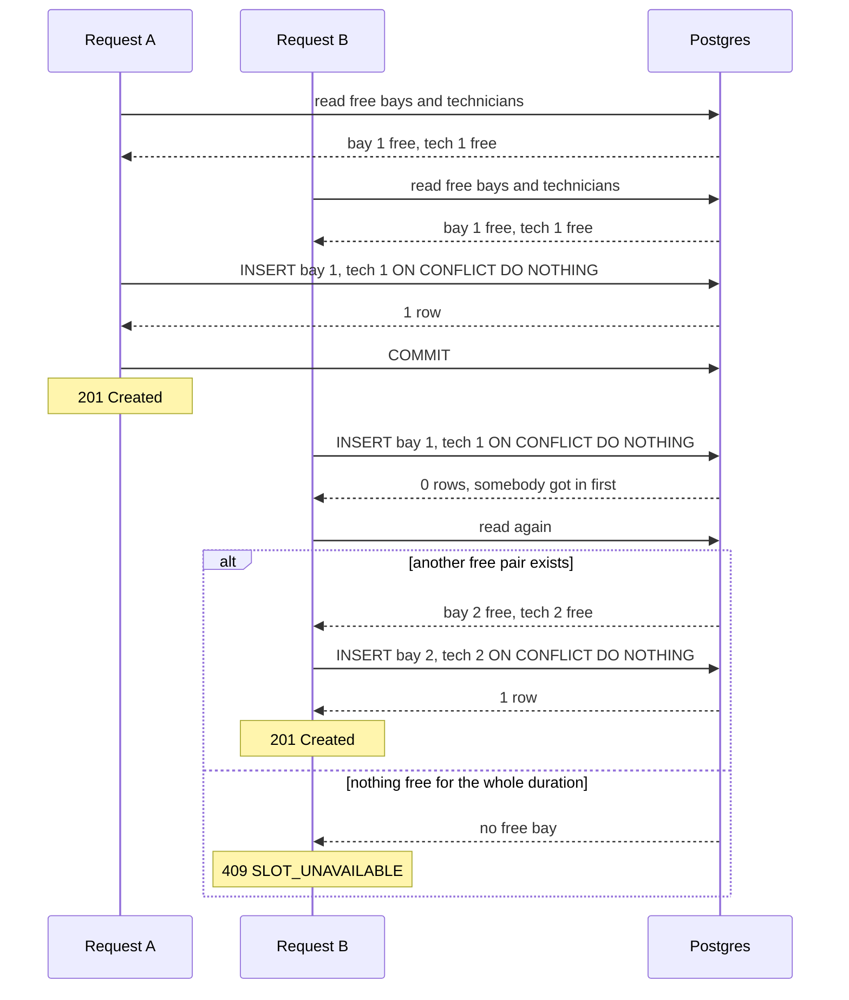

# Design: The Unified Service Scheduler

Status: accepted, 2026-11-10, after a two-reviewer design review. The decisions behind it are in [ASSUMPTIONS.md](ASSUMPTIONS.md) and the ADRs in [docs/adr/](adr/).

## 1. What this is

A backend that books service appointments at car dealerships, to replace booking by phone and spreadsheet. A customer asks for a service type (say an oil change) for one of their vehicles, at one dealership, at a start time. If the dealership can do it, the API creates an `Appointment` that links the customer, the vehicle, a service bay and a qualified technician.

The one hard problem: a booking needs **a free bay and a free qualified technician for the whole service duration**, and two people can ask for the same time at the same dealership at the same moment, through two different API instances. Both can read "bay 1 is free", both insert, and two cars turn up for one bay. My answer ([ADR 001](adr/001-no-double-booking.md)): the database refuses overlaps by itself, and the API is written so that losing a race never turns into a false "fully booked".

## 2. Architecture

The modules inside one API process:

What each part does:

- **Client or cURL.** No frontend. The "stubbed client" is the OpenAPI spec at `/docs` plus the README's cURL examples.
- **`appointments/`.** Controller and DTOs for `POST /appointments` and `GET /appointments/:id`, and the booking service that runs the checks and the loop from ADR 001.
- **`availability/`.** The controller for `GET /availability` and the free bay and technician queries. The booking read uses exactly the constraint's range expression and status filter, so the read and the constraint agree on what "free" means. The day query behind `GET /availability` uses the same status filter, with the half-open overlap rule applied in code.
- **`scheduling/`.** Pure functions (no Nest, Kysely or pg): overlap, opening hours in the dealership's zone, the grid and the booking window. They take the current time as a plain `now` argument, and the service gets it from the injected `Clock`, so the rules never read the system time.
- **`db/`.** Kysely and its table types, the plain SQL migrations (the exclusion constraints live here) and the seed.
- **`common/`.** Problem+json errors with a stable `code`, config, pino logging with a request id, Prometheus metrics and the health checks.
- **PostgreSQL 16.** The only stateful part, and the thing that actually guarantees no double booking, through three exclusion constraints on `appointments`.
- **Logs and metrics.** JSON logs to stdout for whatever collector the platform runs, metrics pulled by Prometheus from `/metrics`.

How it would run in production. Docker Compose in this repo runs the API and Postgres only. The boxes marked planned (dashed) are not built:

## 3. Data model

Ids are UUIDs. Service types are a global catalogue, and a dealership offers one when it has a bay and a technician with the required skill. A missing `opening_hours` row means the dealership is closed that day. Customers and vehicles come from seed data here, and in production they'd come from an upstream system (A12).

The constraints that matter, all on `appointments` unless said otherwise (the why is in [ADR 001](adr/001-no-double-booking.md)):

- **Three exclusion constraints**, one each for bay, technician and vehicle: `(resource_id WITH =, tstzrange(starts_at, ends_at, '[)') WITH &&)` for every row with `status <> 'cancelled'`. This is the real guarantee, for every writer at every isolation level, including a script or somebody in psql. The vehicle one works across dealerships (a car can't be in two places at once, A13). Needs `btree_gist`. A future `completed` or `no_show` status would also hold its resources under `<> 'cancelled'`, which is fine because those rows are in the past.
- **Composite foreign keys** `(dealership_id, service_bay_id)` and `(dealership_id, technician_id)`, backed by `UNIQUE (dealership_id, id)` on `service_bays` and `technicians`, so a bay or technician from another dealership can't end up on the appointment. Customer, vehicle and service type are plain foreign keys.
- **`CHECK (ends_at > starts_at)`** and `NOT NULL` on every id and time. An empty range overlaps nothing and would slip past every exclusion constraint.
- **A CHECK on `status`** that allows only `confirmed` and `cancelled`.
- **`UNIQUE (customer_id, idempotency_key) WHERE idempotency_key IS NOT NULL`**, so two in-flight requests with the same key can't both book, and a CHECK that `idempotency_key` and `request_hash` are both set or both null.
- **`UNIQUE (vin)`** on `vehicles`.
- **`ON DELETE RESTRICT`** on every foreign key, so deleting a bay or technician can't quietly remove confirmed appointments (A22). A customer's deletion request would anonymise the row in place, not delete it.
- An index on `(dealership_id, starts_at)`, which serves the availability query (and a future service desk list). Elsewhere: `CHECK (opens_at < closes_at)` on opening hours, and `duration_minutes` between 1 and 600.

What the database does not check, on purpose:

- **The skill and vehicle ownership.** The service checks both at booking time (the skill in the candidate query). This is an honest asymmetry: the schema guards the facts that must never change (which dealership a bay or technician belongs to), and the service checks facts that can change later (a skill gets removed, a car gets sold). With a foreign key, an old appointment would block either change.
- **Opening hours, the grid and the booking window.** Pure code in `scheduling/`, run before any query.

`updated_at` and `cancelled_at` arrive with the cancel endpoint.

## 4. Data flow for one booking

What happens on `POST /appointments`. When a request breaks more than one rule, the first one wins, in the order fixed in [SPEC.md](SPEC.md#order-of-checks):

1. **Validate the body and headers** (class-validator DTOs). Missing fields, bad UUIDs or a `startTime` without an offset get 400 `VALIDATION_FAILED`.
2. **Idempotency key first.** If there's an `Idempotency-Key`, look it up for that customer before anything else. The stored `request_hash` is over the parsed fields, with the start as a UTC instant. Same hash: return the original appointment with 201 and `Idempotent-Replayed: true`, even if its start has passed by now. Different hash: 422 `IDEMPOTENCY_KEY_REUSED`.
3. **404s**: dealership, service type, customer, vehicle, preferred technician.
4. **422s**: the vehicle belongs to the customer, the preferred technician works there and has the skill (`TECHNICIAN_NOT_ELIGIBLE`), the dealership has a bay and a technician with the skill at all (`SERVICE_NOT_OFFERED`), then the time rules in the dealership's zone: on the grid, not in the past, within 90 days, inside that weekday's opening window. The end is `startTime` plus the duration in real minutes.
5. **The booking loop.** Each attempt is its own short transaction. The service sets READ COMMITTED on every transaction itself (at REPEATABLE READ a lost race would raise an error instead of returning zero rows), and sets `lock_timeout` and `statement_timeout` with `SET LOCAL`. Every attempt starts with one read, then decides in this order:
   - the key is already on a booking (a twin request may have just committed): compare the hash exactly as in step 2. Same request replays, different request gets 422. A twin with a different body must never get back somebody else's booking.
   - the vehicle is booked at an overlapping time anywhere: 409 `VEHICLE_ALREADY_BOOKED`
   - the preferred technician is busy: 409 `TECHNICIAN_UNAVAILABLE`
   - the ordered list of free bays or of free qualified technicians is empty: 409 `SLOT_UNAVAILABLE`
   - otherwise `INSERT ... ON CONFLICT DO NOTHING RETURNING` the first pair (lowest bay id, then the free technician with the fewest skills, then lowest id, A16).
6. **One row back** means booked: commit and return 201. **Zero rows** means someone else got in first, so go round again. The next read works out what changed.
7. **The bound.** A request can lose at most B + T - 1 races (B free bays and T free technicians, counted from the lists in the first read). Past a hard cap of B + T + 2 lost races (T is 1 with a preferred technician), or once the 5 s loop budget is gone before a new attempt, the answer is 503 `BOOKING_CONTENDED` with `Retry-After`, never a 409, because only a fresh read is allowed to say "no slot". Database errors that say nothing about free slots have their own small budget ([SPEC.md, Timeouts and 503](SPEC.md#timeouts-and-503)).

Two requests racing for the same bay. Which branch B takes depends on whether another free pair is left when it reads again:

**The options I rejected** (the full comparison, with the results of the tests I had an agent run, is in [ADR 001](adr/001-no-double-booking.md)):

| Option                                                      | Why not                                                                                                                                                                                                                                                   |
| ----------------------------------------------------------- | --------------------------------------------------------------------------------------------------------------------------------------------------------------------------------------------------------------------------------------------------------- |
| Exclusion constraints with a plain `INSERT`, retry on 23P01 | Safe, but simultaneous inserts deadlock. I measured it myself ([deadlock-repro](evidence/deadlock-repro.sh)): 16 clients for 10 s gave 1 commit and 11 failures. The same run with `ON CONFLICT DO NOTHING` gave 8,819 commits and 0 failures. |
| `SELECT ... FOR UPDATE` on bay and technician rows          | Works only when written exactly right, and the rule lives only in code that another writer can skip                                                                                                                                                       |
| SERIALIZABLE with retry                                     | Aborts bookings that don't overlap (61% retried at 32 clients on an empty table, in the tests I had an agent run), and a writer that forgets the level double books                                                                                       |
| Advisory lock per dealership                                | A convention every writer must follow, and it queues a whole dealership behind its slowest booking                                                                                                                                                        |
| Redis lock                                                  | A second system nothing ties to the data. Without a database constraint behind it, it can double book                                                                                                                                                     |

**Time rules** ([ADR 002](adr/002-time-ranges-and-time-zones.md)):

- A local time that doesn't exist (spring forward) or happens twice (fall back) can't arrive, because every `startTime` carries an offset and so is an exact instant.
- The grid and the opening hours are checked in local time, also on change days. A 23 or 25 hour day just has fewer or more UTC hours, and the dealership still opens at 08:00 local.
- The end is the start plus real minutes. Nothing runs overnight (A6) and clocks change at night, so in practice a job never spans the change.
- The `date` on `GET /availability` is a local date, so it covers whatever UTC span that local day has.

## 5. The API

| Endpoint                                                         | What it does                                                                                                                                                                                                                                                                                                                                                                   |
| ---------------------------------------------------------------- | ------------------------------------------------------------------------------------------------------------------------------------------------------------------------------------------------------------------------------------------------------------------------------------------------------------------------------------------------------------------------------ |
| `POST /appointments`                                             | Body: `customerId`, `vehicleId`, `dealershipId`, `serviceTypeId`, `startTime` (ISO 8601 with offset), optional `preferredTechnicianId`. Optional `Idempotency-Key` header. 201 with the appointment: bay, technician, and times in UTC and in dealership local time. A replay of the same key and request gives 201 with the same appointment and `Idempotent-Replayed: true`. |
| `GET /appointments/:id`                                          | 200 with the appointment, or 404.                                                                                                                                                                                                                                                                                                                                              |
| `GET /availability?dealershipId=&serviceTypeId=&date=YYYY-MM-DD` | `date` is a local date in the dealership's zone. Returns the start times on the 15 minute grid that fit inside that day's opening window, fall inside the booking window (in the future, within 90 days) and have at least one free bay and one free qualified technician for the whole duration.                                                                              |
| `GET /health/live`                                               | 200 whenever the process is up, without touching the database.                                                                                                                                                                                                                                                                                                                 |
| `GET /health/ready`                                              | 200 when the database answers, 503 when it doesn't.                                                                                                                                                                                                                                                                                                                            |
| `GET /metrics`                                                   | Prometheus metrics.                                                                                                                                                                                                                                                                                                                                                            |
| `GET /docs`                                                      | OpenAPI UI, generated from the same DTOs that validate requests.                                                                                                                                                                                                                                                                                                               |

How availability is worked out: three small queries load the day's non-cancelled appointments at the dealership (using the `(dealership_id, starts_at)` index), its bays, and its technicians with the skill, and the slots are computed in code. It looks at resources only, on purpose. It doesn't take a vehicle or a preferred technician, so a slot it shows can still fail with `VEHICLE_ALREADY_BOOKED` or `TECHNICIAN_UNAVAILABLE`. It's a hint, the booking call is the real check.

Errors are `application/problem+json` (RFC 9457) with a stable `code`. Clients switch on `code`, not on the message.

- **400** `VALIDATION_FAILED`
- **404** `DEALERSHIP_NOT_FOUND`, `SERVICE_TYPE_NOT_FOUND`, `CUSTOMER_NOT_FOUND`, `VEHICLE_NOT_FOUND`, `TECHNICIAN_NOT_FOUND`, `APPOINTMENT_NOT_FOUND`
- **409** (not at this time, try another) `SLOT_UNAVAILABLE`, `VEHICLE_ALREADY_BOOKED`, `TECHNICIAN_UNAVAILABLE`
- **422** (this request can never work as asked) `VEHICLE_NOT_OWNED_BY_CUSTOMER`, `OUTSIDE_OPENING_HOURS`, `START_NOT_ON_GRID`, `START_IN_PAST`, `BEYOND_BOOKING_HORIZON`, `SERVICE_NOT_OFFERED` (the dealership has no bay or no technician with the skill at all), `TECHNICIAN_NOT_ELIGIBLE` (the preferred technician works elsewhere or lacks the skill), `IDEMPOTENCY_KEY_REUSED`
- **503** `BOOKING_CONTENDED` with `Retry-After`, whenever the server couldn't decide in time (loop cap or budget, database errors that prove nothing after 3 retries, a statement timeout). One public code because the client does the same thing each time, the metrics keep the reason apart (section 7).
- **503** `SERVICE_UNAVAILABLE` with `Retry-After`, when the database isn't there right now outside the booking loop (a dropped or refused connection, no pool connection in time, a statement timeout in a lookup). A 500 means a real bug, so an outage never looks like one.

The 409 and 422 split is on purpose (A20): a client retries a 409 with another time, so a permanent problem must not look like one.

## 6. Technology choices

The full reasoning is in [ADR 003](adr/003-stack.md). In short:

| Part                    | Pick                                                    | Why                                                                                                         |
| ----------------------- | ------------------------------------------------------- | ----------------------------------------------------------------------------------------------------------- |
| Language                | TypeScript (strict) on Node.js 24 LTS                   | Team-scale default for a REST service, strict mode catches "undefined row" bugs in query code               |
| Framework               | NestJS 12 (ESM)                                         | Modules and dependency injection give a codebase a new team member can find their way around                |
| Database                | PostgreSQL 16 with `btree_gist`                         | Exclusion constraints make "no overlapping bookings" a database fact                                        |
| Data access             | Kysely, plain SQL migrations                            | Typed queries, and the exclusion constraints stay readable SQL instead of hiding outside an ORM schema      |
| Time                    | Luxon                                                   | Zone-aware arithmetic on IANA zones (ADR 002)                                                               |
| Validation and contract | class-validator DTOs, `@nestjs/swagger`                 | The OpenAPI spec comes from the same DTOs that validate, so they can't drift                                |
| Logs, metrics, health   | pino with request id, `prom-client`, `@nestjs/terminus` | Formats every platform understands                                                                          |
| Tests                   | Vitest, fast-check, Testcontainers, supertest           | The double booking guarantee needs a real Postgres to prove. Vitest because Nest 12 and Kysely are ESM-only |
| Run                     | Docker Compose                                          | One command for a reviewer who has only Docker                                                              |

## 7. Observability

**Logs.** Structured JSON through pino. The request id comes from the `X-Request-Id` header (generated if missing), goes on every log line and is echoed back in the response, so a client or support person can hand it over. Each booking request logs one line with the dealership id, the service type id, the outcome (created, replayed, or the error `code`), the `reason` on a 503, the number of attempts the loop took, and the latency. Never customer names, emails or VINs, only ids.

**Metrics** at `/metrics`:

| Metric                                 | What it shows                                                                                                                                            |
| -------------------------------------- | -------------------------------------------------------------------------------------------------------------------------------------------------------- |
| `booking_requests_total{outcome}`      | `created`, `replayed` or the lower-case error code                                                                                                       |
| `booking_contended_total{reason}`      | Every 503 by internal reason: `attempt_cap`, `time_budget`, `db_retries_exhausted`, `statement_timeout`. A burst and a sick database look different here |
| `booking_attempts` (histogram)         | How far the loop walks down the list of bays under a burst                                                                                               |
| `booking_lost_races_total`             | Zero-row inserts                                                                                                                                         |
| `booking_duration_seconds` (histogram) | Booking latency                                                                                                                                          |
| HTTP metrics                           | Requests by route and status, request duration                                                                                                           |
| Connection pool gauges                 | Total, idle and waiting connections. Pool saturation is the first thing I'd expect to go wrong under load                                                |

On the database side, a Postgres exporter for connections, lock waits, deadlocks and (once there is a replica) replication lag.

**Health.** `/health/live` doesn't touch the database and is the liveness probe, so a database blip doesn't make the orchestrator restart every instance at once. `/health/ready` checks the database and is the readiness probe, so the load balancer stops sending traffic to an instance that can't reach Postgres.

**Example alerts** (thresholds are a starting point to tune once there is real traffic):

- any `booking_contended_total` over a few minutes. The cap should basically never be hit. The `reason` says whether to look at a burst (`attempt_cap`, `time_budget`) or at the database (`db_retries_exhausted`, `statement_timeout`).
- the overall 5xx rate above a few percent for 5 minutes.
- booking latency p95 above the 300 ms target (A23) for 10 minutes.
- `/health/ready` failing on any instance.
- Not a page, but worth a dashboard: the 409 `SLOT_UNAVAILABLE` rate per dealership. A dealership that is always full is a capacity signal for the business.

**Tracing, the next step.** OpenTelemetry isn't in the code yet (the request id covers it for now). A booking would be one trace with spans for the HTTP request, the idempotency lookup, the 404 and 422 checks, and each loop attempt (its read and insert as child spans, the attempt number as an attribute).

## 8. Build for the future

**Scalability.** The API is stateless, so it scales by adding instances behind a load balancer. Nothing has to coordinate between them, because the exclusion constraints hold across every instance and every connection. More instances means more connections, so PgBouncer goes in front of Postgres before the connection count gets tight. Each booking attempt is its own short transaction, so connections are held only briefly. `GET /availability` can move to a read replica, since it's only a hint. The booking read must stay on the primary, because a replica that lags would keep offering a bay the constraint keeps refusing. The planning envelope in A23 (my estimate, peak about 10 bookings and 200 availability reads per second) is small for one Postgres primary.

**Performance.** The targets (A23) are `POST /appointments` p95 under 300 ms and `GET /availability` p95 under 200 ms. The exclusion constraints are backed by GiST indexes, which the overlap queries can use too. The worst case is a burst for one slot. In the load test I had an agent run (32 clients all asking for the same slot, 10 bays and 10 technicians, Postgres in Docker on a laptop) a successful booking needed 4.5 attempts on average and 10 at most, well below the cap of 22 for that setup, and the longest wait behind a competitor was 150 ms. Under spread out load there were 13 to 21 lost races in roughly 50,000 requests ([concurrency-experiments.md](evidence/concurrency-experiments.md)). If the attempts histogram shows the walk hurting, the levers are spreading picks across bays or an advisory lock per dealership and day in front of the loop. Partitioning isn't one: Postgres 16 refuses exclusion constraints on partitioned tables, and I checked Postgres 17, which allows them only when the partition key is in the constraint with equality. The vehicle constraint has no dealership in it on purpose, so a newer version doesn't change that. Archiving old rows is the plan instead.

**Reliability.**

- Timeouts on every booking transaction with `SET LOCAL`, so they still work behind PgBouncer in transaction mode: `lock_timeout` 2 s, `statement_timeout` 5 s, a 2 s timeout to get a pool connection, and a 5 s loop budget (no new attempt after 5 s), all from config. 2 s is far above the 150 ms worst wait above, so an ordinary wait never turns into a false 503. One catch behind PgBouncer: the pool also sets the same timeouts as session defaults through the `options` startup parameter, and PgBouncer refuses that parameter unless `ignore_startup_parameters = options` is set. The other way is to put the defaults on the database role (`ALTER ROLE ... SET statement_timeout`). I haven't tested this against a real PgBouncer.
- Bounded retries: B + T + 2 lost races plus the budget, and 3 retries for errors that prove nothing, then an honest 503 with `Retry-After` instead of hanging.
- Postgres itself: a managed Postgres with a standby and point-in-time recovery backups. During a failover, in-flight bookings get a connection error, and the client retries with the same idempotency key. If the first try had committed, the retry gets the booking replayed, otherwise it books fresh.
- Migrations run as a separate job before a rollout (Compose runs them on start, fine for one instance), expand then contract, so old and new instances can run side by side.
- Graceful shutdown lets in-flight bookings finish and closes the pool before the process exits.

**Maintainability.** `scheduling/` has no framework or database imports, so the trickiest logic is tested with plain unit and property tests. The rules that stop double bookings are plain SQL in one migration file (`0002_booking_constraints.sql`), and migrations are never edited after commit. One `npm run ci` gate runs locally and in GitHub Actions.

**Observability.** In from the start, with metrics picked for this design's questions (section 7). Tracing is next.

## 9. Security

There is no auth in this version, so the `customerId` in the body is trusted (A17). In production each caller would authenticate per dealership with OAuth2 or JWT, and the `customerId` would come from the token, not from the body. Input is validated at the edge by the DTOs before any query runs. Rate limits per client would go in front of `POST /appointments` and `GET /availability`. Ids are UUIDs, so they can't be walked by counting up, but that is not access control: until auth exists, anyone with an appointment id can read it. `/metrics` and `/docs` would sit on an internal port or behind auth in production. Logs carry ids only, never names, emails or VINs.

## 10. Assumptions

The brief is open on purpose, so I made 23 calls. Each has its reason in [ASSUMPTIONS.md](ASSUMPTIONS.md). One line each:

| #   | My call                                                                                                                            |
| --- | ---------------------------------------------------------------------------------------------------------------------------------- |
| A1  | Fixed duration per service type. The appointment stores its own start and end                                                      |
| A2  | A service type needs exactly one skill, technicians have a set of skills                                                           |
| A3  | Any bay at the dealership can do any service (no bay types)                                                                        |
| A4  | Each bay and technician belongs to exactly one dealership                                                                          |
| A5  | The system picks the technician. A preferred one is honoured or refused, never swapped                                             |
| A6  | One opening window per weekday in local time, the job starts and ends inside it                                                    |
| A7  | No technician shifts or absences. Available whenever the dealership is open                                                        |
| A8  | Every time carries an offset, stored as UTC, rules checked in the dealership's IANA zone                                           |
| A9  | Starts on a 15 minute local grid                                                                                                   |
| A10 | Start in the future and at most 90 days ahead                                                                                      |
| A11 | Half-open ranges, no gap needed between jobs                                                                                       |
| A12 | Customers and vehicles already exist. The vehicle must belong to the customer at booking time                                      |
| A13 | One vehicle can't have overlapping bookings anywhere                                                                               |
| A14 | Status is `confirmed` or `cancelled`, anything not cancelled holds its resources                                                   |
| A15 | Optional `Idempotency-Key` per customer, same request replays, different request gets 422                                          |
| A16 | Lowest bay id, then the technician with the fewest skills, then lowest id                                                          |
| A17 | No auth, `customerId` in the body is trusted                                                                                       |
| A18 | The vehicle doesn't change who is qualified or how long it takes                                                                   |
| A19 | A lost race never gives a 409 while another free pair exists (losing a preferred technician is a 409)                              |
| A20 | 409 is "not at this time", 422 is "can never work as asked"                                                                        |
| A21 | One service type per appointment                                                                                                   |
| A22 | Bays and technicians with appointments can't be deleted                                                                            |
| A23 | Planning envelope (my estimate): about 1,000 dealerships, peak 10 bookings and 200 reads per second, p95 targets 300 ms and 200 ms |

## 11. What production needs next

- technician shifts, holidays and absences, and dealership closure days (the biggest gap: today a technician counts as available whenever the dealership is open)
- auth per dealership (OAuth2 or JWT), with `customerId` taken from the token
- cancel and reschedule endpoints (the constraints already ignore cancelled rows, so no migration). With cancel, a replay of a cancelled booking needs its own answer, today it would come back as a 201 with status cancelled
- staff blocks (a bay down for maintenance, a walk-in, a phone booking). An exclusion constraint covers one table, so a block has to live in `appointments` (say a `kind` column), or the "database refuses overlaps" story breaks
- notifications through an outbox table written in the booking transaction
- an audit trail of who booked, changed or cancelled what
- rate limits
- OpenTelemetry tracing
- bay types (lift, alignment rig), mirroring the skill model
- fairer technician assignment than "fewest skills, then lowest id"
- fewer round trips per booking: the lookups before the loop are six to nine single-row queries one after another, and can be one query. Dealership hours and service types can be cached in process
- a version on the stored idempotency request hash (`v1:...`) before the first new booking field is added, or old keys would answer 422 to their own retries
- check a dealership's time zone when it's written (there's no admin write path yet, so today a typo is found by the first booking as a 500)
- smaller ones: an "active" flag for bays and technicians, buffers between jobs, combined visits (several services in one visit) and multi-day jobs

## 12. How I used AI agents in the design phase

I worked with one main agent and gave the well-scoped pieces to other agents, each with a written brief. The rule I kept for myself: agents explore, draft and review, I decide. Every agent wrote its output to a file, and every review got a written decision per finding, so nothing rests on "the agent said so".

How it went, in order:

- **Assumptions first, by hand.** I wrote the first pass of ASSUMPTIONS.md myself, then gave it to a fresh devil's advocate agent with only the brief and my list, and the instruction not to propose a design. It came back with 11 open questions and 17 concrete edge cases. The ones that changed the design: an appointment has to store its own end time (or a later change to a service's duration would silently move old bookings), the vehicle overlap must not be scoped to one dealership, and greedy lowest-id assignment refuses work that would have fit. That last one is why the least flexible technician gets picked first.
- **The data model, by me.** I wrote it before asking anyone, because it's the part I'd have to defend.
- **The concurrency decision, explored by the strongest model, decided by me.** I asked a Fable agent to compare six approaches on trade-offs and explicitly not to pick one. It went further than I asked and ran ten experiments on Postgres 16 with pgbench. Its most important finding contradicted the design I had in mind: plain `INSERT` with a retry on 23P01 deadlocks when two inserts land at the same instant. I didn't take that on trust, since the whole ADR would rest on it. I reproduced it with my own two-line schema (16 clients: 1 commit and 26 deadlocks with plain `INSERT`, 8,819 commits and none with `ON CONFLICT DO NOTHING`). The script and output are in [docs/evidence/](evidence/). That's how `ON CONFLICT DO NOTHING` ended up in ADR 001.
- **A second opinion before committing to it.** The advisor review of my ADR 001 draft caught a real ordering bug: my loop said "no slot" before it looked up the idempotency key, so a retry of a booking that had taken the last bay would get a 409 instead of its own appointment. It also caught that I had read the agent's report while the agent was still editing it. Lesson taken: read an agent's output after it hands back, not during.
- **Spec: my main points, then an agent to fine-tune it.** I wrote the acceptance criteria and checked every date and offset with code. A reviewer agent then found that several of my test setups would let a 409 pass for the wrong reason (one existing booking holds a bay, a technician and a vehicle at once, so the test can't tell which one refused), and that my daylight saving test could never fail. I decided each finding and sent the decisions back to the same agent to apply, then read the result in full.
- **The golden duo on this document.** Two reviewers read the same draft independently. Reviewer A had the full context of my session. Reviewer B had only the brief and this page. A was best at "the doc says it but nothing makes it true" (READ COMMITTED was never actually set, and the session timeouts wouldn't survive PgBouncer). B found the one real logic bug: a twin request with the same idempotency key but a different body would have been handed somebody else's booking. A had traced that exact path and missed it, because it assumed the twin had the same body. That's the reason I run two reviewers with different context. B also made me change the data model (I dropped the composite ownership key, because cars get sold). I wrote down a decision on every finding.

What I'd say I owned: the scope, the data model, the choice between the concurrency options, the order of checks, and every accept or reject on a review finding. What the agents gave me: a much wider search for edge cases than I'd have done alone, experiments I wouldn't have had time to run, and two honest readings of the design from different angles.
